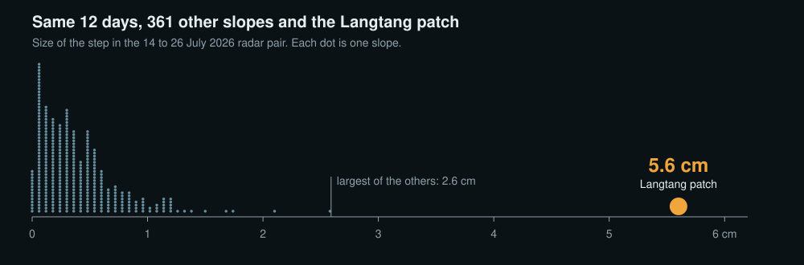
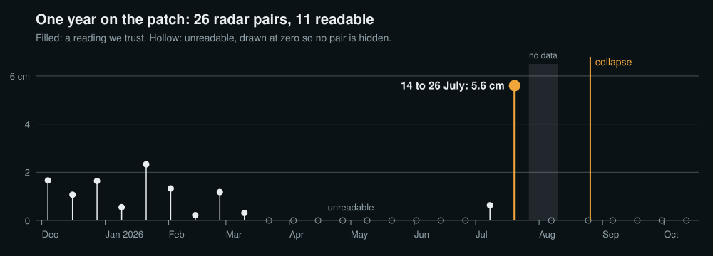
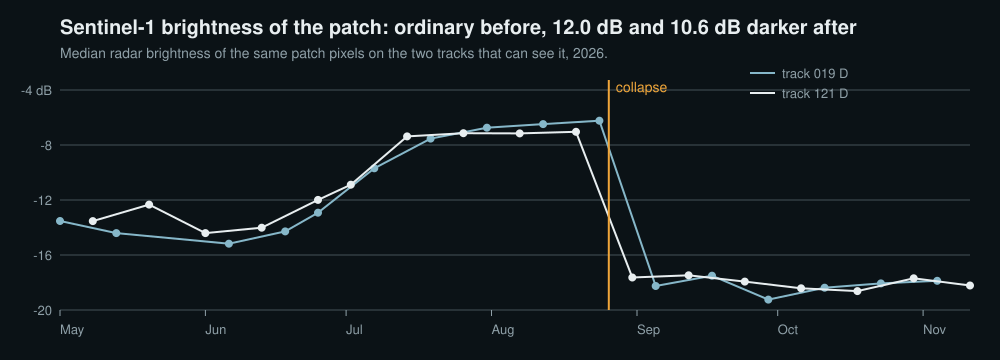

# SlopeWatch — Dancing with the SARs

A NASA Space Apps Challenge 2026 research prototype investigating what satellite observations can tell us before and after a destructive mountain collapse.

**Case study:** Langtang Lirung, Nepal, 26 August 2026.

**Status, 15 November 2026:** retrospective analysis and an interactive website. Not an operational monitoring or public-warning service.

[Website](https://dancing-with-the-sars-docs.vercel.app/) · [Detailed results](project/results.md) · [Independent reconstruction research](notes/Langtang%20event%20reconstruction%20-%20independent%20research.md)

## Why we chose this project

This project began with a question we had carried since childhood: if satellites surround Earth, why do disasters still arrive without warning? After the Langtang disaster, we wanted to know whether the mountain had shown changes beforehand, whether satellites recorded them, and whether those observations could help people responsible for downstream communities, roads and hydropower infrastructure.

We initially imagined a glacier slowly melting, blocking a river and filling a reservoir before a flood. Investigating the reports taught us that this sequence cannot be assumed. The updated event account describes a rock-and-ice collapse that developed into a destructive debris-rich flow; the role and timing of temporary blockages need separate evidence. Gradual environmental change and sudden failure are compatible. We have not established that the whole glacier melted or that a reservoir grew for days before this disaster.

Our motivation remains the same: make unusual changes in high-mountain terrain easier to investigate, and make gaps in the observations visible. Our research question is:

> Can satellite observations identify unusual surface changes on a mountain slope, distinguish them from ordinary seasonal change, and provide an evidence package useful for expert review?

Langtang provides a documented event against which to examine observations before and after failure. Because we selected the case knowing the outcome, it is a development case, not independent evidence that our method predicts future disasters.

## What we found

These are results recorded in the project's analysis, not a completed reconstruction of every stage of the disaster. Methods, parameters and qualifications are in [the results record](project/results.md).

| Finding | Evidence | What it does not establish |
|---|---|---|
| Unusual pre-collapse NISAR phase signal | On a selected 0.056 km² patch, the 14–26 July wrapped-phase step is equivalent to 4.7–5.6 cm along the radar line of sight across five reference choices. It exceeds all 361 readable controls in that pair. | Confirmed ground displacement, its physical direction, acceleration, or impending failure. |
| Processing choices affect visibility of the signal | The 20 m wrapped layer retains the patch; the 80 m unwrapped analysis discarded it. | That finer pixels always produce more reliable measurements. |
| Strong surface change across the collapse | NISAR backscatter changes within the mapped footprint. Sentinel-1 patch brightness falls about 12.0 dB and 10.6 dB on two tracks across the event, exceeding their sampled controls. | Meltwater volume, flood depth, or a pre-event warning. |
| A plausible seasonal signal was rejected | June–July Sentinel-1 brightening also occurs in 2025. The final 24 August brightness observation is ordinary relative to controls. | That the slope was safe or that no movement occurred. Brightness is not displacement. |
| Event-adjacent optical observations exist | Fresh NASA catalog queries identify Sentinel-2 on 24 August and Landsat on 26 August, about 1 h 56 min after the reported collapse. Local quality masks were checked. | That the collapse was filmed or that these scenes reveal a growing reservoir. |

The 361 controls above are readable in the July pair alone. A separate comparison uses 289 controls readable in both July pairs; these are different selection criteria.







The three charts are drawn from the result files by `scripts/readme_figures.py`.

Our experimental detector generated **270 flags over 22 evaluated pairs**, including two flag regions on the Langtang slope in one July pair. **The other 268 flags are unverified.** They are not confirmed hazards or confirmed false alarms. The detector was adjusted using Langtang, so its success on this case is not independent validation.

## What is missing

- **Independent precursor confirmation:** establish whether the July phase signal represents slope movement, using complementary observations and tests for snow, atmosphere and terrain effects.
- **The final approach to failure:** our NISAR patch measurement is unresolved over 26 July–19 August. Tested Sentinel-1 interferograms do not supply a reliable displacement measurement there. This is a limitation of these analyses, not an absence of all observations.
- **The source-to-river sequence:** validated locations and dates for deposition, any blockage, temporary lake and drainage. The slope coordinate must not be presented as a dam coordinate.
- **Hydrological evidence:** original gauge records and terrain constraints before claiming water-level rise, stored-water volume or flood arrival times.
- **Independent evaluation:** test the frozen detector on other failures and non-failing slopes, with seasonal controls, to measure missed events and unnecessary reviews.
- **Operational feasibility:** establish product availability dates, processing delays, coverage, and who could review and act on a flag. Acquisition time alone is not usable warning time.

## Limitations

Satellites observe at particular times and viewing angles, rather than continuously recording every place. Optical scenes can be obscured by clouds or terrain shadow. Radar works through clouds but suffers from layover, shadow, loss of coherence and phase ambiguity in steep, changing terrain. Different sensors cannot simply be combined into an uninterrupted displacement record.

Our patch and method were selected with knowledge of the eventual collapse. Nearby controls strengthen the comparison but do not remove selection bias or establish performance elsewhere. One radar viewing direction does not resolve three-dimensional motion. The physical sign and total magnitude of movement remain unverified.

The newer optical quality check covers the existing rectangular radar patch box, not the entire failure or river. All passing 24 August pixels and most passing 26 August pixels carry high-aerosol flags. Passing cloud checks does not validate reflectance, snow loss or water classification. Water area is not water depth; terrain loss is not necessarily ice melt.

The website's existing optical before/after views are from autumn 2025 and October–November 2026. They illustrate lasting landscape change, not the hour-by-hour event. The newer optical inventory has not yet been turned into a validated image reconstruction.

We cannot currently predict collapse time, demonstrate that a warning could have prevented this disaster, or conclude that an agency ignored a usable warning. We have not established scientific novelty relative to all published work.

## What comes next

1. Inspect event-adjacent optical imagery across the source and river corridor, preserving timestamps, masks and uncertain areas. Trace the published Planet 25/26 August comparison to original scene metadata.
2. Combine checked surface-change maps, terrain products and gauge records into a dated reconstruction. Test the temporary-lake explanation instead of assuming it.
3. Evaluate the frozen detector on held-out events and non-failing slopes. Classify a documented sample of other flags before reporting detection performance.
4. Develop a review workflow as the evidence supports it: record unusual change, attach supporting scenes and quality information, identify potentially connected downstream infrastructure, and request expert assessment.

The longer-term ambition is a monitoring aid for specialists: a watch list of changes deserving attention. A warning service would require prospective validation, reliable delivery, local instruments where appropriate, and an agreed response process with responsible agencies. Those capabilities are not implemented here.

## Sources and attribution

- NASA–ISRO NISAR and ESA Sentinel-1 through NASA Earthdata/ASF; OPERA RTC-S1 for Sentinel-1 brightness.
- NASA Harmonized Landsat Sentinel-2 (HLS) for optical imagery. HLS is a processing product, not an additional satellite.
- UNOSAT for mapped event geometry; source-position provenance is documented in the research notes.
- [IRDR updated event report](https://www.irdrinternational.org/knowledge_pool/publications/142). The [older PreventionWeb summary](https://www.preventionweb.net/publication/documents-and-publications/rapid-analysis-report-scientific-anatomy-26-august-2026) retains a different, 18–19-hour blockage explanation. Version differences matter.
- [ICIMOD preliminary synthesis](https://lib.icimod.org/records/qdvc1-tc123) and [Li preprint](https://arxiv.org/html/2609.04563v2): external context, not results generated here.
- [WorldView-derived post-event terrain dataset](https://zenodo.org/records/22842746): identified for follow-up, not yet analysed here. License: CC BY-NC 4.0; original imagery has separate rights.

NASA does not endorse this project. Data and publications retain their own licenses and attribution requirements.

## Run the website

```sh
cd docs
python -m http.server 8765
```

Open [the local website](http://127.0.0.1:8765/). The static application is in `docs/`.

## Reproduce the analysis

Python dependencies include numpy, scipy, Pillow, h5py, fsspec, requests and pytest. Science-file downloads require an Earthdata Login. Raw data are not committed.

```sh
cd scripts
python series_fetch.py
cd ..
python pipeline/build.py
python -m pytest tests -q
```

The backscatter build also requires GCOV extracts from `scripts/lang_gcov.py` and UNOSAT input from `scripts/lang_export_unosat.py`. See [HANDOFF.md](HANDOFF.md) for the inventory and processing details. These commands are not a complete download of every study input.

For the newer optical catalog and quality screening, run from the repository root:

```sh
python scripts/event_optical_inventory.py
python scripts/event_optical_quality.py
```

The inventory uses public metadata; quality screening downloads Fmask through the existing Earthdata login. Outputs go to `data/event_reconstruction/`. These checks do not measure melting or lake growth.

Create an [Earthdata account](https://urs.earthdata.nasa.gov/) and configure `.netrc` in your home directory, outside this repository:

```text
machine urs.earthdata.nasa.gov login YOUR_USERNAME password YOUR_PASSWORD
```

Never commit credentials. The top-level `data/` directory is excluded from git.

## Repository guide

| Location | Contents |
|---|---|
| `project/results.md` | Numbers, negative findings, calibration history and caveats |
| `project/` | Specification, plan, progress and reviews |
| `pipeline/` | Core analysis and generated-data build |
| `scripts/` | Acquisition, exploration and verification |
| `tests/` | Synthetic-data tests and checks requiring local extracts |
| `docs/` | Website and committed display data |
| `notes/` | Research, source audits and independent checks |
| `HANDOFF.md` | Earlier session state; consult the newer reconstruction note for the latest source audit |
